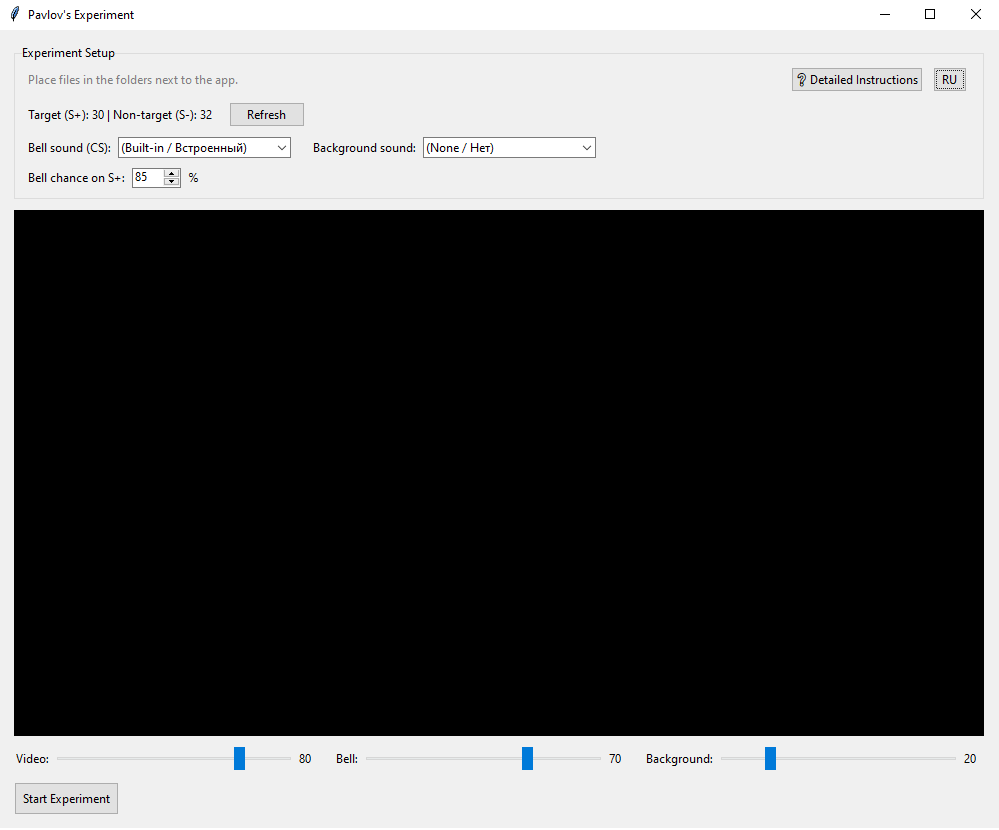

# Pavlov's Experiment (Эксперимент Павлова)

**[🇷🇺 Читать на русском (Read in Russian)](README.ru.md)**

A GUI application for conducting a classic psychological experiment on classical conditioning.

## 🧠 Experiment Overview
The participant is presented with videos divided into two categories:
* **Target Stimulus (S+)** — reinforced with a bell sound (Conditioned Stimulus) and background audio.
* **Non-target Stimulus (S-)** — not reinforced.

The program automatically shuffles videos using a proportional interleaving algorithm (so S+ and S- alternate evenly) and allows you to set the probability of the bell playing (e.g., 85% to maintain the subject's vigilance).

## 🖥️ Interface



## 🚀 How to Run the App (for participants)
1. Download `pavlov_gui.exe` from the **Releases** section (on the right).
2. Place the `.exe` in any convenient folder and run it.
3. The program will automatically create the following folders next to it:
   * `videos_S_plus` — place target videos here.
   * `videos_S_minus` — place non-target videos here.
   * `sound_bell` — place bell sounds here (if empty, a built-in sound is used).
   * `sound_background` — place background sounds here.
4. Click the "Refresh" button in the app and start the experiment.

## 🛠️ For Developers (Running from source)
1. Install Python 3.12.
2. Install dependencies: `pip install -r requirements.txt`
3. Install VLC media player.
4. Run the script: `python pavlov_gui.pyw`

## 📦 Building to EXE
To build the project into a single file, PyInstaller is used:
```bash
pyinstaller --noconfirm --onefile --windowed --add-data "libvlc.dll;." --add-data "libvlccore.dll;." --add-data "plugins;plugins" pavlov_gui.pyw
