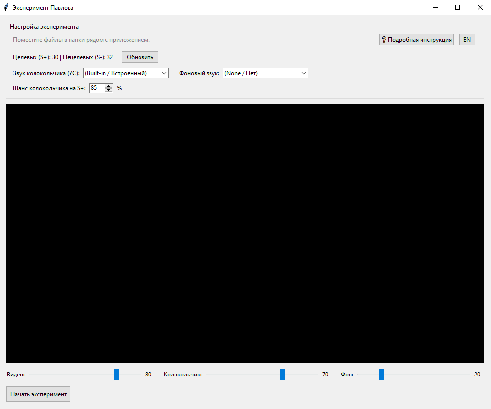

# Эксперимент Павлова (Pavlov's Experiment)

**[🇬🇧 Read in English (Читать на английском)](README.md)**

Графическое приложение (GUI) для проведения классического психологического эксперимента по изучению условных рефлексов.

## 🧠 Суть эксперимента
Участнику предъявляются видео, разделенные на две категории:
* **Целевой стимул (S+)** — подкрепляется звуком колокольчика (Условный стимул) и фоновым звуком.
* **Нецелевой стимул (S-)** — не подкрепляется.

Программа автоматически перемешивает видео по алгоритму пропорционального чередования (чтобы S+ и S- шли равномерно), а также позволяет настроить вероятность появления колокольчика (например, 85%, чтобы поддерживать бдительность испытуемого).

## 🖥️ Интерфейс


## 🚀 Как запустить готовую программу (для испытуемых)
1. Скачайте файл `pavlov_gui.exe` из раздела **Releases** (справа на этой странице).
2. Поместите `.exe` в любую удобную папку и запустите двойным кликом.
3. Рядом с программой автоматически появятся папки:
   * `videos_S_plus` — сюда кладите целевые видео.
   * `videos_S_minus` — сюда кладите нецелевые видео.
   * `sound_bell` — сюда кладите звуки колокольчика (если пусто, будет встроенный).
   * `sound_background` — сюда кладите фоновые звуки.
4. Нажмите кнопку «Обновить» в программе и начинайте эксперимент.

## 🛠️ Для разработчиков (Запуск из исходников)
1. Установите Python 3.12.
2. Установите зависимости: `pip install -r requirements.txt`
3. Установите VLC media player.
4. Запустите скрипт: `python pavlov_gui.pyw`

## 📦 Сборка в EXE
Для сборки проекта в один файл используется PyInstaller:
```bash
pyinstaller --noconfirm --onefile --windowed --add-data "libvlc.dll;." --add-data "libvlccore.dll;." --add-data "plugins;plugins" pavlov_gui.pyw
